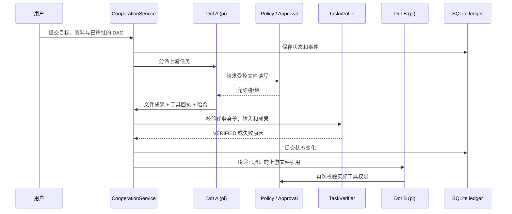

# 架构设计与关键取舍

> 来源：冻结工程源码 `f3fee23588e1963ae9eecd47d8c5e2170ef9dbb7`，这里是公开的技术整理，不包含私有运行资料。

## 1. 设计核心

**模型负责提出候选，可信宿主负责执行与结果判断。** Planner 可以提出 DAG，但校验器须检查依赖是否成环、Dot 是否存在、工具权限及输入引用是否允许；候选计划经用户审批后才能开始工作。人工编写的计划与模型生成的候选分别记录来源。

### 执行链路

## 2. 持久任务和恢复

- 使用 SQLite 存放**项目快照**，同事务同步目标状态索引、事件日志与唤醒队列；不能将这直接称为完整 event-sourcing。
- 使用租约和递增 **fencing token**，在写入前检查当前所有权，抑制旧执行者在失去租约后继续提交。
- 持久副作用状态包括授权、已开始、已确认与 **UNKNOWN**。发生不确定外部效果时先对账、避免盲目重放；**不保证跨文件系统/网络服务的 exactly-once**。
- 恢复通常重新启动新的 run/session，而不是恢复已消失的模型内部思考状态。

相关选摘：[durable-ledger.ts](code-excerpts/src/main/cooperation/durable-ledger.ts) · [durable-ledger.test.ts](code-excerpts/src/main/cooperation/durable-ledger.test.ts)。

## 3. 工具安全与产物验证

- 工具请求经策略与审批；一次性 ActionGateway 能力绑定 project、Dot、task、run、toolCall、参数哈希、scope 与有效期。
- 受控工具集限于 `workspace_read`、`artifact_save`、`check_code`，其中 `check_code` 为封闭算术语法检查器，**不是通用 JavaScript 执行环境**。
- 真正完成须有物理文件、对应 hash、真实输入读取回执与声明的可检验条件；模型文字声明不能代替 VERIFIED。
- 新版 TaskVerifier 增加 taskId/runId/format 检查和严格 JSON 哈希保存回执。
- 用户可选填独立的顶层验收文本条件，模型生成的子任务条件不能直接覆盖它；该检查属于**字面文本**合同，不是开放语义正确性证明。

相关选摘：[action-gateway.ts](code-excerpts/src/main/cooperation/action-gateway.ts) · [task-verifier.ts](code-excerpts/src/main/cooperation/task-verifier.ts)。

## 4. Memory 与 Skills

Memory 支持用户、Dot、项目与任务四个作用域、用户优先更新、修订历史、删除标记与恢复。它主要是结构化/文本存储，**未验证大规模语义召回或 RAG 水平**。

Skills 继续使用上游 Organisation 体系，在候选版本上增加内容哈希、可信宿主测试、人工批准、撤销和回滚。用户可复用 Skill，但该机制**不是模型权重训练**，历史小样本 A/B 没有证实性能收益。

## 5. 模型与框架

pi 仍然是协作路径的 Runtime；模型路由为确定性候选，实际受 provider/digest/权限/资源和已有实验证据约束。本项目在冻结版尚未证明“任意 Runtime 即插即用”或“多模型自动选择提升效果”。测试后端只为验证协议，不冒充真实大模型。

## 6. 核心边界

Node 静态路径/句柄检查不等于 Windows OS 安全沙箱；SQLite 与任意外部工具无跨系统原子事务。当前限定范围适用于**可信桌面宿主 + 受控工具集**，不是对抗主机恶意进程的完整安全产品。

完整已知限制：[LIMITATIONS.md](LIMITATIONS.md)。
