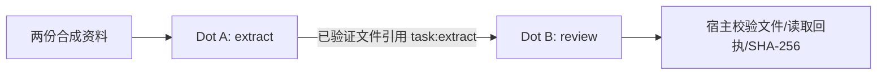

# 合成演示：两个 Dot 的文件交接

这份脱敏示例仅展示已验收流程中**公开可用的合成资料**，不包含本机路径、Dot 会话 ID、数据库和审批记录。

## 输入

```text
[source:K1] Indigo stores 29 samples.
[source:K2] Quartz stores 13 samples.
```

## 人工审核的任务图



- 两个 Dot 使用不同 pi 会话；
- 第二 Dot 消费的是第一 Dot 的**实际保存文件**，不是模型口头声明；
- 用户在保存时经原生批准；另一个拒绝测试项目没有写入副作用；
- 中断后重启新 run，旧状态不被伪装成执行完成。

## 固定示例输出

```text
[source:K1] Indigo stores 29 samples.
[source:K2] Quartz stores 13 samples.
Comparison: Indigo has 16 more samples than Quartz.
```

**重要：** 该文本由 *deterministic HTTP fixture* 按预定规则产生；两个最终文件内容在该测试中相同。它用于检验**执行路径、授权、保存、交接和恢复协议**，不能作为第二 Dot 具有独立推理能力的证据。

验收标准和限制参见 [VERIFICATION.md](VERIFICATION.md) 与 [LIMITATIONS.md](LIMITATIONS.md)。
