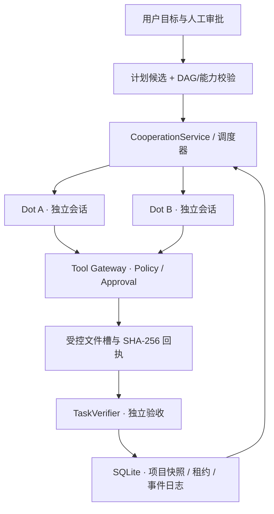

# OpenDot Enhanced · 多 Agent 协作与可靠执行框架

> **公开技术展示 / Selected Source Showcase** · 2026-11 · 工程原型（Engineering Prototype）  
> 基于 [OpenDot](https://github.com/athulsreekumar/opendot) 与 pi 的二次开发。**不是从零训练或研发的大语言模型，也不是完整公开发布的桌面应用。**

**技术栈：** TypeScript · Electron · React · Node.js · SQLite · pi Agent Runtime  
**研究重点：** Agent Harness、DAG 任务编排、持久执行、权限审批、可信执行回执、Memory / Skills 治理

## 解决什么问题？

语言模型驱动的 Agent 可能会重复调用工具、误报任务完成，或在执行中断后丢失状态。这个项目将模型输出视为**待验证的计划和操作请求**，由可信宿主管理权限、执行状态和交付证据，而不是相信一句“已经完成”。

## 主要技术模块

| 模块 | 工程设计 | 当前证据范围 |
|---|---|---|
| 多 Dot 协作 | 任务 DAG、独立 pi AgentSession、经校验的上游产物引用与消费事件 | 限定场景下有实际文件交接 |
| 持久任务 | SQLite 项目快照、事件记录、Tick、运行租约与 fencing token、恢复机制 | 事务、竞争与中断测试 |
| 执行安全 | 受控文件工具、ApprovalBroker / PolicyEngine、一次性能力与副作用账本 | 审批拒绝与迟到操作防护 |
| 结果验证 | 输入读取回执、task/run 身份、SHA-256、保存回执与声明验收条件 | 字节/协议层验证；非完整语义证明 |
| Memory / Skills | 用户/Dot/项目/任务作用域；修订/删除历史；Skills 测试、批准、撤销 | 治理能力，不等于自学习性能提升 |

## 总体架构

查看 [详细架构](ARCHITECTURE.md)、[源码选摘](code-excerpts/README.md)。

## 冻结版本的验收摘录

本项目内部收尾版本源码标识：`f3fee23588e1963ae9eecd47d8c5e2170ef9dbb7`，Windows x64/Electron 44.5.1。以下为该版本已有的本地验收记录，**不是此公开源码选摘仓库重新跑出的测试成绩**：

| 验收类别 | 记录结果 | 必须理解的边界 |
|---|---|---|
| desktop Vitest | **1,123 PASS，0 FAIL，2 SKIP** | 包含上游基线测试，非个人新写 1,123 项 |
| 打包应用 UI E2E | **34 / 34 PASS** | 使用 FakeProvider |
| 原生双 Dot HTTP fixture | **6 组检查 PASS** | 确定性测试后端，不是 6 个模型任务 |
| 真实模型新版验收 | **BLOCKED（未运行）** | 当前不存在已授权可用的推理后端 |

演示主要验证：两份合成资料 → 第一 Dot 保存文件 → 第二 Dot 读取真实上游文件 → 哈希与回执校验；另外覆盖拒绝不写入、暂停/关闭后安全恢复。演示采用**人工计划与确定性 HTTP fixture**，**不证明通用自主规划或模型推理能力**。

详情：[验收证据说明](VERIFICATION.md) · [合成演示](DEMO.md) · [已知限制](LIMITATIONS.md)。

## 公开范围与源码

本页公开了架构、设计取舍、经过筛选的原始代码片段及相关单元测试；它们来自上述冻结源码，保留原始相对路径映射。**选摘不构成可独立编译的完整 Electron 工程。** 完整工程仓库仍为私有，原始运行数据库、会话、模型、日志、个人路径、未审查图片和 Windows 可执行程序不在此公开。

- [Cooperation Schema / DAG](code-excerpts/src/shared/cooperation.ts)
- [DurableLedger / fencing](code-excerpts/src/main/cooperation/durable-ledger.ts)
- [ActionGateway / 一次性授权](code-excerpts/src/main/cooperation/action-gateway.ts)
- [TaskVerifier / 结果验收](code-excerpts/src/main/cooperation/task-verifier.ts)
- [TaskAwareRouter / 可解释模型选择](code-excerpts/src/main/models/task-router.ts)
- [代表性反例测试](code-excerpts/src/main/cooperation/task-verifier.test.ts)

## 项目来源与贡献边界

上游 OpenDot 提供 Electron/React AppShell、基础 Dot、连接器、审批界面与 pi 集成；本项目在其基础上重点扩展多 Dot 受控协作、持久状态/恢复、独立验证与 Memory/Skills 治理。开发过程中使用 AI 编码工具辅助工程实现，不应将上游或模型权重包装为原创。

[贡献说明](CONTRIBUTIONS.md) · [许可与公开边界](PUBLICATION_SCOPE.md) · [MIT 许可证](LICENSE)

---

**工程定位：** 可检验的个人 Agent Harness 原型。现有演示与验收只证明限定范围内的执行协议和状态管理；不主张 Grok Bot 等商业产品的能力百分比、不主张通用 OS 沙箱、任意系统调用的 exactly-once 或已证实的自主学习增益。
